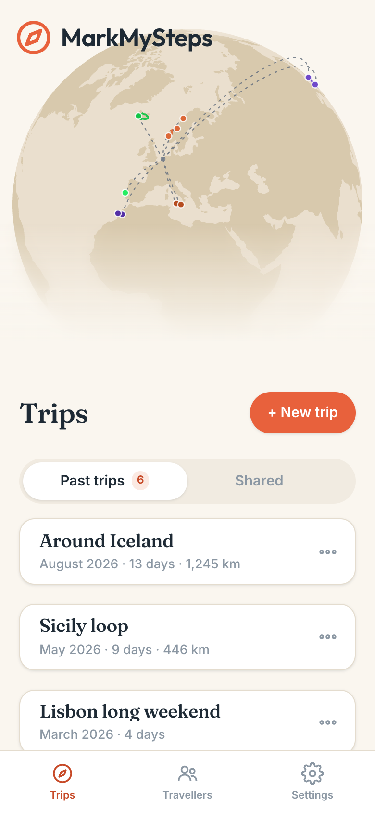
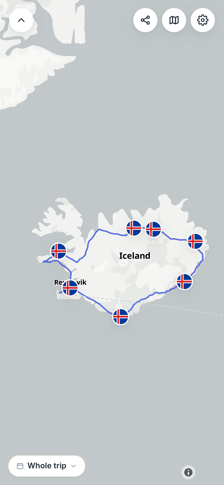
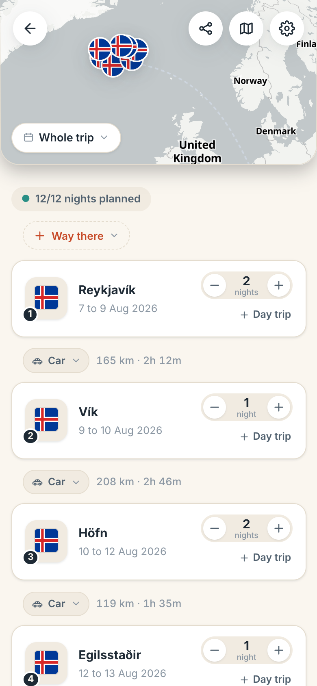
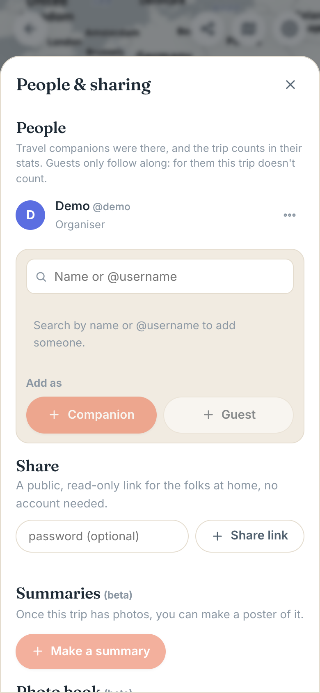
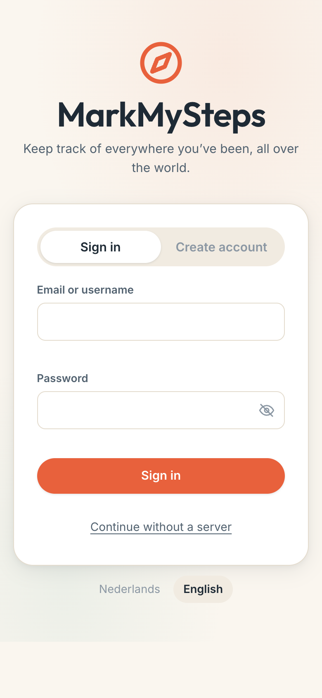

# MarkMySteps

[](https://github.com/Marukiee/MarkMySteps/releases/latest)
[](LICENSE)
[](#install-the-android-app)

English | [Nederlands](README.nl.md)

**A self-hosted travel tracker and Polarsteps alternative.** Plan your route with draggable stops, track your trip without draining your battery and without Google, and relive it later on a map that looks good. Your photos stay where they are: in your phone's gallery, or on your own [Immich](https://immich.app) server. MarkMySteps does not copy them.

## Screenshots

<p>
  
  
  
  
  
</p>

## What it does

- **Map and globe** (MapLibre and OpenFreeMap), no API keys, no Google. One route per traveller, photos as markers with clustering, and each person can be switched on or off
- **Route planner.** Stops with "X nights": change one and every date after it moves along. Transport per leg (car, train, bus, boat, flight with stopovers), and day trips that leave from a stop without moving your plan
- **Battery friendly tracking.** An Android app on the AOSP location service, so no Google Play Services. It works on LineageOS and GrapheneOS. One fix per interval, closer together once you are really on the move, and buffered offline until there is a connection again
- **Photos.** From your phone's gallery or from your own Immich server. Either way they are matched to a trip by date and placed on the map by their EXIF location
- **Works without a server.** Everything can run on your phone alone. You can connect a server later without entering anything again
- **Polarsteps import.** Upload your "Download my data" zip: trips, full GPS tracks and stops come along
- **Travel together.** Shared trips, combined routes and photos, and a private link for the people at home, who do not need an account
- **Yours.** The database has no port to the outside, there is one web port that only listens on localhost (meant to sit behind a Cloudflare Tunnel), and Immich keys are stored encrypted (AES-256-GCM). Logging in can take a second step from your authenticator app, and admins get a message when someone keeps trying an account

## Choose how you use it

| | Phone only | With your own server |
| --- | --- | --- |
| Good for | Trying it out, travelling alone | Travelling together, sharing, a backup of your trips |
| You need | An Android phone | Also a computer that stays on, with Docker |
| Account | None | On your own server |
| Photos | From your gallery | From your gallery or your Immich server |

You can start with the phone only and add a server later. Your trips go along in one go.

## Install the Android app

1. Download `markmysteps.apk` from the [latest release](https://github.com/Marukiee/MarkMySteps/releases/latest) on your phone.
2. Open it. Android asks once whether the app you open it with (your browser or files app) may install apps from unknown sources. Turn that on, go back and tap Install.
3. Open the app and choose **Continue without a server** and enter your name. No account, no password, nothing leaves your phone. Or enter the address of your server and log in.
4. Set location to **Allow all the time** if you want tracking to continue with the screen off.

It works without Google Play Services. The web app also runs as a PWA in any mobile browser, but tracking needs the screen to stay on there. You can add the repository to [Obtainium](https://obtainium.imranr.dev) for updates.

## Run your own server

A server is just a computer that stays on: an old laptop with Linux, a Raspberry Pi or a NAS. You need Docker.

```bash
git clone https://github.com/Marukiee/MarkMySteps.git && cd MarkMySteps && ./install.sh
```

The installer asks once for the address you want to reach the app on, makes all the keys, builds everything and shows what to fill in at Cloudflare Tunnel. The default port is `18790` (change it with `WEB_PORT`). Update with `git pull && ./install.sh`, remove with `./uninstall.sh`.

The full guide, in plain steps, is **[docs/SELF-HOSTING.md](docs/SELF-HOSTING.md)**:

- how to make the server reachable (Cloudflare Tunnel, your own reverse proxy, or your own network only)
- connecting Immich and importing from Polarsteps
- updating, backing up and removing
- two step verification, limits and security

## Built with

| Layer | Used |
| --- | --- |
| Backend | NestJS, Prisma, PostgreSQL 16 with PostGIS |
| Frontend | React, Vite (PWA) |
| Mobile | Capacitor (Android, own plugins, no GMS) |
| Maps | MapLibre GL, OpenFreeMap, Photon geocoding |
| Weather | Open-Meteo |
| Deployment | Docker Compose, Cloudflare Tunnel |

## Build it yourself

You need Node 22 or newer, pnpm and Docker. The local setup is at the bottom of [docs/SELF-HOSTING.md](docs/SELF-HOSTING.md). Architecture and planning are in [docs/PLAN.md](docs/PLAN.md) (Dutch).

## License

AGPL-3.0, see [LICENSE](LICENSE). Made by Mark Maakt Media. The round country flags in `apps/web/public/flags` come from [circle-flags](https://github.com/HatScripts/circle-flags) (MIT).
